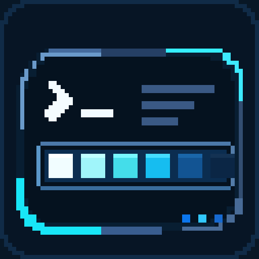
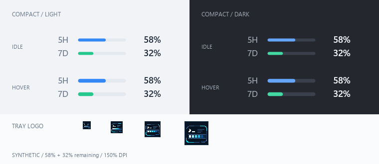

<p align="center"></p>

# QuotaRail

A lightweight, native Windows taskbar monitor for your Codex quota.

在 Windows 11 任务栏中查看 Codex **剩余额度**与重置时间。无需反复打开终端或网页，支持任务栏常驻、独立浮窗和系统托盘。

**当前版本：v0.1.0-beta.1，早期预发布。** 已验证环境和功能限制见[兼容性说明](docs/compatibility.md)。本项目与 OpenAI 无隶属关系。

## 核心功能

- **真实账户额度**：通过本机 Codex CLI App Server 读取，按窗口时长识别 5H / 7D；不把本地 Token 用量当作订阅额度。
- **三种显示方式**：默认任务栏内部显示，可切换可拖动浮窗或仅托盘。任务栏绑定失败时保留托盘及原因提示。
- **点击查看详情**：剩余/已用比例、重置时间、倒计时和更新时间；更多额度桶从“全部详情”查看。
- **按需刷新**：默认约 5 分钟，可设置 5–60 分钟；手动刷新、重连、失败退避与明确的过期状态。
- **原生设置**：明暗主题、位置锁定、恢复位置、Codex 来源与默认关闭的当前用户开机启动。
- **本地缓存**：保留上次成功读数，历史缓存单独标记；不把缺失或失败伪装成 0%。

<p align="center"></p>

截图使用合成数据：5H 剩余 58%、7D 剩余 32%，不含真实账户信息。图标中的装饰进度不表示实际额度。

## 下载与运行

1. 在 Windows 原生 CMD / PowerShell 中安装并登录 Codex CLI，确认 `codex --version` 可用。
2. 从 [Releases](https://github.com/strive-yang/QuotaRail/releases) 下载 `QuotaRail-v0.1.0-beta.1-windows-x64.zip`。首版只提供 Windows x64 便携包。
3. 解压到固定目录，双击 `quotarail.exe`，无需管理员权限。不要直接在 ZIP 内运行。
4. 点击额度条查看详情；右键额度条或托盘图标打开设置。托盘图标可能位于“显示隐藏图标”中。

首版没有安装器、自动更新或代码签名。将下面结果与同一 Release 的 `SHA256SUMS.txt` 对照；校验和用于检查文件一致性，不等同于发布者签名。

```powershell
Get-FileHash .\QuotaRail-v0.1.0-beta.1-windows-x64.zip -Algorithm SHA256
```

默认任务栏模式支持主屏、居中、底部布局；会为天气预留空间。空间不足或布局不受支持时，可在托盘设置中切换浮窗或仅托盘。使用其他布局前请阅读[兼容性说明](docs/compatibility.md)。

## 使用方式

数字与进度条都表示**剩余百分比**。5H 显示 58% 表示该窗口还剩 58%，不是已用 58%。重置时间由服务端提供；服务端未返回的窗口显示为缺失，不补成 0%。

点击额度条或托盘打开详情，点击外部或按 Escape 收起。拖动调整位置，右键锁定、恢复默认位置或重新挂载任务栏。外观、显示模式和刷新间隔可在设置中直接修改。

命令行覆盖已保存设置。同一数据目录只运行一个实例；使用命令行切换模式前先退出已有实例，也可直接在设置中切换。

```powershell
.\quotarail.exe --tray-only
.\quotarail.exe --floating
.\quotarail.exe --taskbar
.\quotarail.exe --taskbar --taskbar-left-space 320
.\quotarail.exe --codex "C:\Tools\Codex\codex.exe" --refresh-minutes 10
```

| 选项 | 说明 |
| --- | --- |
| `--taskbar` / `--floating` / `--tray-only` | 三种互斥方式；不指定时沿用设置，首次默认任务栏 |
| `--taskbar-left-space 0..1024` | 任务栏左侧预留 DIP，默认 240；只用于任务栏模式 |
| `--refresh-minutes 5..60` | 自动刷新间隔，默认 5 分钟 |
| `--codex PATH` | 指定本机原生 Codex 可执行文件 |
| `--codex-home ABSOLUTE_PATH` | 指定已有登录目录；默认 `CODEX_HOME` 或用户的 `.codex` |
| `--data-dir ABSOLUTE_PATH` | 指定独立配置/缓存目录 |

手动刷新有 30 秒冷却；临时失败会退避，联网恢复后可能需要等待或手动刷新。外部重新登录或切换账户后，请选择“重新连接 Codex”。本版不提供多账户管理。

## 数据、缓存与卸载

默认目录 `%LOCALAPPDATA%\QuotaRail`：

| 文件 | 内容 |
| --- | --- |
| `settings.json` | 显示模式、刷新间隔和 Codex 来源路径 |
| `widget.json` | 主题、位置与锁定状态 |
| `cache-salt.bin`、`quota-*.json` | 本地盐及额度缓存、来源键和加盐账户键 |

QuotaRail 不自行读取或保存认证令牌，不创建模型任务，不收集提示词或代码；认证与额度请求交由 Codex CLI 处理。缓存不含完整账户 ID，但来源路径、额度和时间仍应作为个人数据保留在本地。详见[隐私说明](PRIVACY.md)。

自启动默认关闭，需要在设置中主动开启。移动程序后从新位置重新保存启动选项。卸载时先取消自启动并保存，再退出并删除程序目录；如需清除配置/历史，退出后删除自己的数据目录。不会删除 Codex 登录数据。

## 从源码构建

需要 Windows x64、Rust stable MSVC 工具链，以及 Visual Studio Build Tools 的 C++ 桌面开发组件和 Windows SDK。开发验证使用 Rust 1.99.1；尚未声明最低 Rust 或 Codex CLI 版本。

```powershell
git clone https://github.com/strive-yang/QuotaRail.git
cd QuotaRail
cargo build --release --bin quotarail --bin quota_probe --locked
```

程序位于 `target\release\`。图标已提交，普通构建无需 Node.js。`quota_probe.exe --json` 可用于一次性诊断；输出可能包含账户字段，请勿直接上传。

## 参与贡献

通过 [Issues](https://github.com/strive-yang/QuotaRail/issues) 反馈问题，附 Windows build、缩放、任务栏布局、QuotaRail / Codex CLI 版本与脱敏复现步骤。

- [贡献与验证](CONTRIBUTING.md)
- [兼容性与已知限制](docs/compatibility.md)
- [隐私说明](PRIVACY.md)与[安全报告](SECURITY.md)
- [更新记录](CHANGELOG.md)与[维护者发布流程](docs/releasing.md)

源码与本项目图标按 [MIT License](LICENSE) 发布；依赖许可证独立适用，发行包附带第三方声明与许可证文本。
